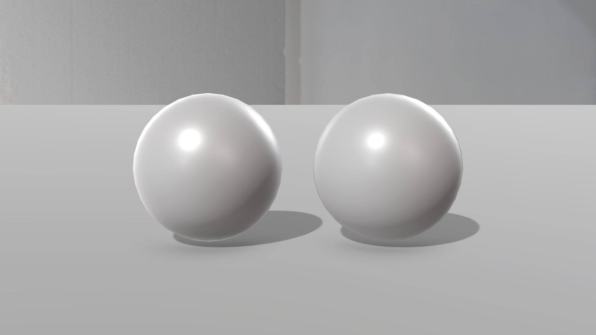
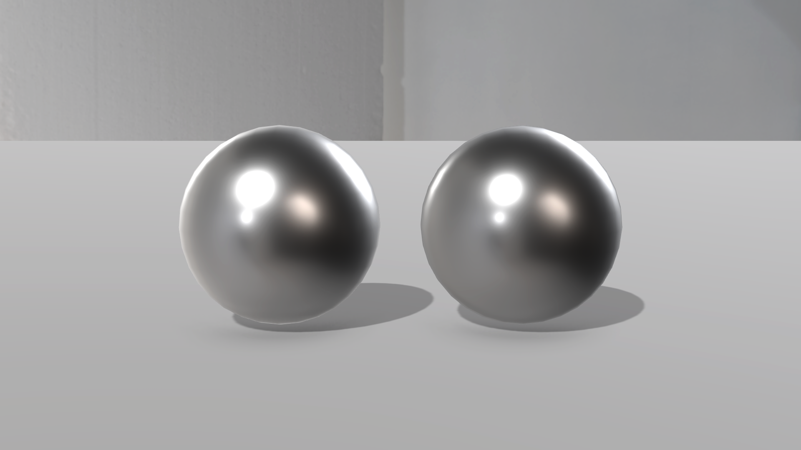
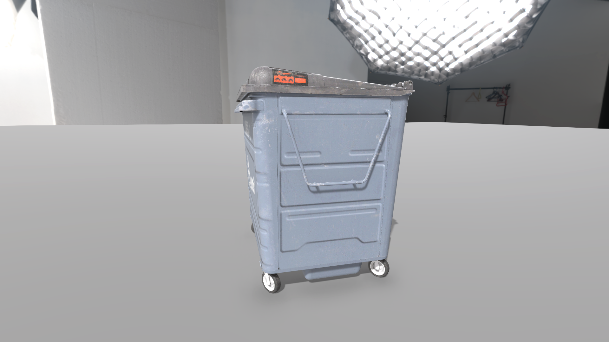

# URP LookDev PBR

在 Unity URP 里手写 Cook-Torrance BRDF，并且放进一个仿虚幻默认效果的 LookDev 场景，和 URP 自带光照逐像素对比，最后接入一套自己做的 PBR 资产检验全流程。

- 配套文章（知乎）：https://zhuanlan.zhihu.com/p/2095633841343967585
- 手写的 shader：[`Assets/LookDev/MyAssets/BRDF/URP_Shader.shader`](Assets/LookDev/MyAssets/BRDF/URP_Shader.shader)
- 21 个版本的演化记录（每版一张图：改之前 / 改之后 / 代码改动）：[演化记录.md](演化记录.md)
- 截图用的光照和后处理设置：[测试环境.md](Screenshots/测试环境.md)







## 实现了什么

- 直接光：兰伯特漫反射 + Cook-Torrance 高光（D：GGX，G：Smith-Schlick，F：Schlick），漫反射按 (1 − F)(1 − 金属度) 扣除能量
- 间接光：球谐漫反射 + 反射探针高光，菲涅尔用带粗糙度的版本，高光项用 EnvBRDFApprox 近似
- AO 只作用于间接光；直接光乘回 π，与 Unity 的灯光强度约定对齐
- 和 URP 自带光照在同一像素上的比值：1.003（RenderDoc 读数，后处理之前）
- 阴影、深度、深度法线借用 URP Lit 的 pass（UsePass），因此不兼容 SRP Batcher

## 哪些是手写的

| 部分 | 文件 |
|---|---|
| **手写 BRDF shader**（本项目的主体，逐行手写） | `Assets/LookDev/MyAssets/BRDF/URP_Shader.shader`，以及 `MyAssets/` 下用它的材质 |
| 对比用的参考 shader（调用 URP 自带的 `UniversalFragmentPBR`，不是手写 BRDF） | `Assets/LookDev/Shaders/LookDev_ReferencePBR.shader` |
| LookDev 场景和辅助工具（非手写部分，借助 AI 搭建） | `Assets/LookDev/Shaders/LookDevProbe.hlsl`、`Assets/LookDev/Editor/`、`Assets/LookDev/Scripts/`、`Tools/` |

对比图里，左边的球用参考 shader，右边的球用手写 shader。

参考资料：

- Brian Karis, *Real Shading in Unreal Engine 4*, SIGGRAPH 2013 Course: Physically Based Shading in Theory and Practice（[课程页](https://blog.selfshadow.com/publications/s2013-shading-course/)）
- LearnOpenGL CN：[PBR 理论](https://learnopengl-cn.github.io/07%20PBR/01%20Theory/)、[漫反射辐照度](https://learnopengl-cn.github.io/07%20PBR/03%20IBL/01%20Diffuse%20irradiance/)

## 环境

Unity 2022.3.62f3c1 + URP 14.0.12（Forward），线性色彩空间，画质档 URP-HighFidelity。

HDRI 来自 Poly Haven（CC0）：studio_small_09、kloofendal_48d_partly_cloudy_puresky、hotel_room，都是 4K。

**注意**：演示用的垃圾桶模型和贴图是私人资产，没有放进仓库。打开场景后它会显示为缺失，换成自己的模型和贴图就行。

---

## 如何使用这个场景

### 打开
Unity Hub → Add → 选本工程文件夹 → 打开 `Assets/LookDev/Scenes/LookDev.unity`。

### 场景里有什么
| 物体 | 用途 |
|---|---|
| `== LookDev 总控 ==` | 切 HDRI、转天空、太阳方向/强度、曝光、ACES 开关、Bloom 开关、背景开关 |
| `== 对比区（贴图在这里填） ==` | 填一次贴图，同时塞给左边的参考材质和右边的测试材质 |
| `ReferenceSlot_URP自带PBR` | 左：`LookDev/Reference PBR (URP, MRO)`，光照用 URP 官方 BRDF，当标准答案 |
| `TestSlot_我的Shader` | 右：`Assets/LookDev/MyAssets/Mat_MyShader.mat`，换成要检验的 shader |
| `== 参考球 ==` | 铬球（看反射）/ 18% 灰（看曝光）/ 80% 白 |
| `== 粗糙度阶梯 ==` | 上排金属、下排非金属，粗糙度 0→1，用来对比高光形状 |
| `== ColorChecker 色卡 ==` | X-Rite 24 色，检查色彩 / 色调映射 |

后处理按虚幻默认风格配置：ACES 色调映射、Bloom（阈值 1）、轻微暗角、SSAO、4096 软阴影、MSAA 4x 加 SMAA、HDR 64 位缓冲。

### 检验流程
1. 把 shader 和贴图拷进 `Assets/LookDev/MyAssets/`（重建场景不会动这个文件夹）。
2. 贴图导入设置：基础色勾 sRGB；MRO 关 sRGB；法线的 Texture Type 选 Normal map。
3. 选中 `Mat_MyShader`，把 Shader 换成要检验的。
4. 选中 `== 对比区 ==`，把贴图拖进去；如果 shader 的属性名不是 `_BaseColor / _Normal / _MRO / _Height`，在下面改。
5. 换模型：拖到两个 Slot 下面，把默认球体关掉。

MRO 通道约定：R = 金属度，G = 粗糙度，B = AO。

### 操作
- 编辑模式：直接改总控 Inspector。换 HDRI 或旋转天空后，停手约 0.3 秒会自动重烘一次反射。
- 运行模式（Play）：左键拖动 = 绕物体转；中键 = 平移；滚轮 = 推拉；Shift + 左键 = 转 HDRI；F = 回到初始机位；1/2/3 = 切 HDRI；B = 背景开关；L = 太阳开关；T = 转台。
- 菜单 `LookDev/重建场景`：重新生成整个场景，`Generated/` 和场景文件会被覆盖。

### 自写 shader 接入阴影 / SSAO
只写一个 ForwardLit pass 的话，物体不投影，SSAO 也拿不到它的法线。在 SubShader 末尾加上：
```
UsePass "Universal Render Pipeline/Lit/SHADOWCASTER"
UsePass "Universal Render Pipeline/Lit/DEPTHONLY"
UsePass "Universal Render Pipeline/Lit/DEPTHNORMALS"
```
要接收环境光，就在片元里加 `SampleSH(normalWS)`（漫反射）和 `GlossyEnvironmentReflection(...)`（镜面反射），否则只有太阳光。

### 已知差异
URP 的 BRDF 是简化版：漫反射乘固定的 0.96 ×（1 − 金属度），高光用移动端近似公式，和虚幻的 Smith-joint 高光形状不完全一样。另外 URP 没有自动曝光，曝光要在总控里手动调。

---

## 工具

### 在 VS Code 里跳转到 URP 源码（F12）
1. 装插件 HLSL Tools（TimGJones.hlsltools）。
2. 在工程根目录建 include 链接（Unity 的 include 写的是 `Packages/包名/...`，实际文件在 `Library/PackageCache/包名@版本`）：
   ```powershell
   New-Item -ItemType Junction -Path .shaderinclude\Packages\com.unity.render-pipelines.core -Target Library\PackageCache\com.unity.render-pipelines.core@14.0.12
   New-Item -ItemType Junction -Path .shaderinclude\Packages\com.unity.render-pipelines.universal -Target Library\PackageCache\com.unity.render-pipelines.universal@14.0.12
   ```
   升级 URP 后版本号会变，要删掉重建。
3. 用 VS Code 打开工程根目录。`shadertoolsconfig.json` 已配好 include 路径和 `SHADER_API_D3D11`。
4. 在函数、结构体、宏上按 F12 跳到定义，Alt+F12 原地预览。shader 里有编译错误时，错误后面的代码可能跳不了，先修错误。

### 调试探针（一行输出任意变量）
`Assets/LookDev/Shaders/LookDevProbe.hlsl`。在 shader 里接入三行：
```
Properties:  [Toggle(_LD_PROBE_ON)] _LDProbe("调试探针", Float) = 0
Pass:        #pragma shader_feature_local_fragment _ _LD_PROBE_ON
             #include "Assets/LookDev/Shaders/LookDevProbe.hlsl"    // 放在 Lighting.hlsl 后面
```
在片元着色器任意位置写 `LD_PROBE(变量);`（数值/颜色）、`LD_PROBE_DIR(变量);`（方向）、`LD_PROBE_SIGNED(变量);`（正数绿、负数红）。材质上勾选"调试探针"才生效。

### 快速输出中间值（VS Code 插件）
插件源码在 `Tools/vscode-ld-quick-return/`，安装：把这个文件夹复制到 `%USERPROFILE%\.vscode\extensions\local.ld-quick-return-0.0.1`，重启 VS Code。

- **Ctrl+Alt+D**：选中一个变量或表达式（光标停在变量上也行），插件会找到片元着色器（`#pragma fragment` 指定的函数）**最后一个 return**，在它前面插入 `return float4(变量, 1); // LD临时`，光标跳过去
  - 自动判断维度：`float` 补 `.xxx`，`float3/float4` 补 `.rgb`；名字像方向的（`xxxDir`、`normal`、`tangent`、`R`、`h`）自动 `* 0.5 + 0.5`
  - 认不出维度时弹出列表选择
- **Ctrl+Alt+S**：异常检测（看第一个分量）：红 = 负数，绿 = 正数，黑 = 0，蓝 = NaN。只看"是不是"不看大小，再小的负数也是纯红
- **Ctrl+Alt+R**：删掉所有带 `// LD临时` 的行
- 选中的是一个单独的名字、但片元函数里没有这个变量（比如别的函数的参数 `NoV`）时会提示，不会插入
- 插入是一次编辑，**Ctrl+Z 就能撤销**
- 不用改 shader、不用勾选项。调试时记得关掉总控里的 ACES

### 生成文章配图的脚本
- `Assets/LookDev/Editor/LookDevHistoryCapture.cs`：把每个历史版本的 shader 在固定机位下批量截图
- `Tools/render_code_diff.py`：把每次提交的 shader 改动渲染成代码图（红删绿加）
- `Tools/compose_history.py`：把同一版本的效果图、代码图和注释拼成一张，生成演化记录里的图
